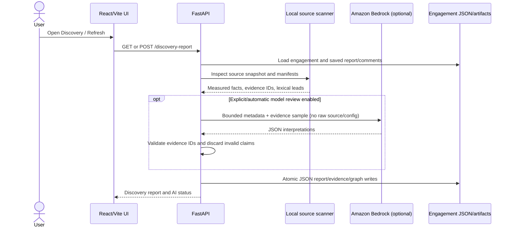

# Nexus Modernize — Discovery Phase Reference

**Document status:** Repository-backed discovery snapshot  
**Prepared:** 20 November 2026  
**Scope:** Nexus Modernize control-plane repository. This is not a production runbook or a complete legacy application specification.  
**Evidence rule:** “Observed” means present in checked-in code/docs/configuration; “Inferred” means derived from naming or architecture; “Not documented” means the repository does not provide evidence. Confirm inferred items with the application owner before using for delivery.

## Contents

1. Modernization Context & Legacy Crosswalk
2. Local Development & Codebase Onboarding
3. Functional Specifications & Business Logic
4. Low-Level Technical Architecture
5. Data Layer & Persistence Reference
6. Security, Auth & Compliance Implementation
7. Testing, CI/CD & Maintenance Workflows
8. Debugging, Observability & Production Support

## 1. Modernization Context & Legacy Crosswalk

### Modernization Summary & ADRs

Nexus Modernize is an AWS-centered modernization **control plane**. It accepts source repositories, ZIPs, folders, or a curated IBM CICS GenApp sample; performs inventory and source-backed discovery; organizes evidence into graph and capability views; supports scope approval, semantic requirements and stories; and can generate test and handoff artifacts. AWS Transform is an optional later connector, not the discovery engine used by the current source-backed Discovery view. The default sample is insurance/GenApp, region `us-east-1`; the README says v1 has no login.

| ADR | Decision and reason | Evidence / consequence |
|---|---|---|
| ADR-001: deterministic local discovery first | Measure paths, manifests, declarations, and lexical references from source; use AI only for bounded interpretation. This keeps measured facts visible if model access fails. | `docs/discovery-evidence.md`, `apps/api/app/discovery_report.py`. Source facts are not compiler or runtime proof. |
| ADR-002: explicit Bedrock for Discovery | Discovery calls Amazon Bedrock directly, independent of the older `LLM_PROVIDER`; no silent provider/model fallback. | `discovery_report.py`; model chosen from `DISCOVERY_BEDROCK_MODEL`, then `BEDROCK_MODEL_REASONING`, default Nova Pro. |
| ADR-003: evidence-linked graph edges | .NET AKG edges require parser evidence and file/line locations; unresolved expressions produce no edge. | `docs/applied-knowledge-graph.md`; tree-sitter C#/TS grammars avoid claiming a complete Roslyn semantic model. |
| ADR-004: file-backed engagement persistence | Engagement state and discovery reports are JSON alongside each engagement for a lightweight demo and downloadable artifacts. | `apps/api/app/store.py`, `discovery_routes.py`; no shared relational database or multi-instance persistence guarantee is documented. |
| ADR-005: human phase gates | Approval/rejection is explicit and ordered; approval snapshots Discovery evidence for downstream phases. | `main.py`, `phases.py`; downstream snapshots can become stale when source changes. |

### Legacy-to-Modern Crosswalk

The repo ships a **curated GenApp demo seed**, not verified legacy production documentation. These names are demo mappings only.

| Legacy/demo item | Modern equivalent in repository | Confidence / caveat |
|---|---|---|
| SSC1 — Customer 3270 screen | Customer capability in demo graph; source-derived UI/API workflow where source is supplied | Demo seed only; no screen-by-screen functional mapping. |
| SSP1 — Policy 3270 screen | Motor capability in demo graph | Demo seed only. |
| GENADAY — Nightly policy extract | No modern scheduled-job equivalent identified | Not documented; do not infer a replacement. |
| GENAREP — Customer reprint | No modern scheduled-job equivalent identified | Not documented. |
| CUSTOMER (DB2), KSDSCUST (VSAM) | Customer capability/table nodes in demo graph | Not a production schema or deployed database mapping. |
| POLICY, MOTOR (DB2), KSDSPOLY (VSAM) | Motor capability/table nodes in demo graph | Not a production schema or deployed database mapping. |
| HOUSE (DB2) | Home capability/table node in demo graph | Not a production schema or deployed database mapping. |
| LGACUS01, LGUCUS01, LGICUS01 | Demo customer add/update/inquire program nodes | No modern service implementation mapping is validated. |
| LGAPOL01, LGIPOL01, LGDPOL01, LGUPOL01 | Demo motor policy add/inquire/delete/update nodes | No parity evidence in this repository. |

### Known Limitations & Tech Debt

- General repository analysis is heuristic; module boundaries, integrations, and lexical references need expert review. .NET AKG is parser-based but intentionally narrower than Roslyn semantic analysis.
- Discovery skips `.git`, dependency/build folders, symlinks, and files over 2 MB; unreadable/invalid files are reported. LOC is physical lines, including comments and blanks.
- Model review samples up to 160 evidence records; valid evidence links do not establish that interpretations are true. Cost is deliberately null where not measured.
- Coverage, complexity, security, license, EOL, owners, and runtime call behavior are not verified by Discovery.
- The demo seed includes illustrative outputs (including telemetry, readiness, parity, and CDC helpers); do not treat them as measured production observations without validating their implementation and source data.
- Local JSON persistence and in-process locks are not a demonstrated multi-worker or production database strategy.
- The README labels several integrations as later/optional; do not assume AWS Transform execution, GitHub publishing, or tracker credentials are configured.

## 2. Local Development & Codebase Onboarding

### Zero-to-One Setup Guide

Requirements observed from manifests: Python with a version supporting the pinned dependencies (exact Python version is **not pinned**); Node/npm compatible with Vite 6 and TypeScript 5.8 (exact Node version is **not pinned**). Docker/Compose files were not found in the discovered repository.

From repository root, use two PowerShell terminals:

```powershell
cd .\aws-modernization\apps\api
python -m venv .venv
.\.venv\Scripts\Activate.ps1
pip install -r requirements.txt
Copy-Item .env.example .env
uvicorn app.main:app --reload --port 8000
```

```powershell
cd .\aws-modernization\apps\web
npm install
npm run dev
```

Open `http://localhost:5173`. The frontend uses the API on localhost; inspect `apps/web/src/api.ts` for the base URL behavior. Health check: `GET http://localhost:8000/api/health`. No Docker Compose setup is documented.

### Environment Variables & Secrets

Never place credentials in engagement artifacts or commit `.env`. `apps/api/.env.example` is the key inventory; `load_dotenv()` loads the API environment. Defaults below are code defaults when present.

| Key(s) | Purpose / default | Secret? / notes |
|---|---|---|
| `AWS_REGION` | AWS region; default `us-east-1` | No. |
| `DISCOVERY_BEDROCK_MODEL` | Discovery model override | No; falls through to `BEDROCK_MODEL_REASONING`, then `amazon.nova-pro-v1:0`. |
| `BEDROCK_MODEL_REASONING` | Reasoning model fallback for Discovery | No. |
| `BEDROCK_API_KEY`, `AWS_BEARER_TOKEN_BEDROCK` | Bedrock bearer credential; first nonempty key is used | Yes. No local secret-fetch command documented. |
| `BEDROCK_KEY_NAME`, `BEDROCK_MODEL_ID` | Present in example env; active use varies by pipeline path | Do not assume Discovery uses these values. |
| `AWS_TRANSFORM_TENANT_ID`, `AWS_TRANSFORM_SERVICE_PROFILE_ARN`, `AWS_TRANSFORM_PORTAL_URL` | Optional Transform metadata/configuration | Not proof of a live Transform run. |
| `AWS_S3_INTAKE_BUCKET`, `AWS_S3_INTAKE_PREFIX`, `AWS_S3_SSE`, `AWS_S3_KMS_KEY_ID`, `AWS_S3_ENDPOINT_URL`, `AWS_PROFILE` | Optional source staging; prefix defaults to `nexus-modernize/intake`, encryption defaults to `AES256` | IAM/profile credentials use standard boto3 chain; require `s3:PutObject`; KMS permissions when applicable. |
| `ADO_ORG`, `ADO_PROJECT`, `ADO_PAT` | Azure DevOps export | PAT secret. |
| `JIRA_BASE_URL`, `JIRA_PROJECT_KEY`, `JIRA_EMAIL`, `JIRA_API_TOKEN` | Jira integration | API token secret. |
| `BITBUCKET_WORKSPACE`, `BITBUCKET_REPO`, `BITBUCKET_USERNAME`, `BITBUCKET_APP_PASSWORD`, `BITBUCKET_TOKEN` | Bitbucket integration | Password/token secret. |
| `GITHUB_REPO`, `GITHUB_TOKEN` | GitHub integration/publish | Token secret. |

No feature-flag catalog or secret manager fetch procedure was found. Blank optional integration credentials disable corresponding integrations.

### Repository & Module Map

| Path | Responsibility |
|---|---|
| `apps/api/app/main.py` | FastAPI routes, phase gates, orchestration. |
| `apps/api/app/discovery_report.py`, `discovery_routes.py`, `discovery_projection.py` | Source scan, evidence/report APIs, approval projection. |
| `apps/api/app/dotnet_akg/` | Solution/project parsing, C#/TS graph and analysis. |
| `apps/api/app/knowledge_graph.py`, `analyzers.py`, `as400.py`, `classifier.py` | Graph and language/platform analysis. |
| `apps/api/app/seed.py`, `ingest.py`, `store.py` | Intake, demo/source-derived seed and JSON persistence. |
| `apps/api/app/business_logic.py`, `legacy_assessment.py`, `scope_modules.py`, `sir_generator.py`, `user_stories.py` | Functional extraction, scope, requirements and stories. |
| `apps/api/app/test_scenarios.py`, `playwright_gen.py` | Scenario/test artifact generation and execution support. |
| `apps/api/app/bedrock_skills.py`, `llm_gateway.py`, `llm_json.py`, `pii_scrubber.py` | AI prompts/integration and preprocessing. |
| `apps/api/app/ado.py`, `aws_intake.py`, `github_deployer.py` | Optional external integrations. |
| `apps/api/data/engagements/<id>/` | Runtime engagement JSON, source snapshot and artifacts (created locally; not source-controlled data). |
| `apps/web/src/pages/` | Home and engagement pages. |
| `apps/web/src/components/` | Discovery, gates, graph, scope, semantic IR, stories, tests, tracker UI. |
| `docs/` | Discovery evidence and AKG methodology. |
| `samples/as400-life-insurance/` | IBM i sample reference material. |

### Test Data & Mocking Setup

The curated sample action clones CICS GenApp; arbitrary Git and ZIP intakes are also supported. Tests and fixtures live under `apps/api/tests/`, including `legacy_shop`, `modern_tickets`, and `*.reference.json`. The API test suite uses Python unittest/pytest-style tests. No dedicated third-party mock server, database seed command, or Compose service is documented. Tests should use fixtures and injected/mock HTTP where present; inspect individual tests before assuming a mock topology.

## 3. Functional Specifications & Business Logic

### Feature-to-Code Traceability Matrix

This table maps the product workflows visible in this repository; it is not a complete business specification for the imported legacy application.

| Workflow / UI | Frontend | API / service | Persistence/evidence |
|---|---|---|---|
| Dashboard and engagement creation | `pages/HomePage.tsx` | `POST /api/engagements/{git,sample,zip,folder}`, `GET /api/engagements` — `ingest.py` | `engagement.json`, source folder, inventory. |
| Discovery review and comments | `components/DiscoveryReport.tsx` via `PhasePanels.tsx` | `GET/POST /api/engagements/{eid}/discovery-report`, `POST .../discovery-comments` — `discovery_report.py` | `discovery-report.json`, `discovery-comments.json`, `artifacts/discovery*.json`. |
| Gate approval and snapshot | `components/GateBar.tsx`, `pages/EngagementPage.tsx` | `POST /api/engagements/{eid}/gates/{phase}` | Gate state in `engagement.json`; approved snapshot in `artifacts/discovery-approved.json`. |
| Knowledge graph and overrides | `AKGGraphView.tsx`, `AppliedKnowledgeGraph.tsx`, `GraphView.tsx` | `GET/POST .../knowledge-graph`, `GET/PUT .../akg-overrides` | Seed graph and override JSON; source-specific graph evidence. |
| Scope and modules | `ScopePanel.tsx`, `AKGModules.tsx`, `ScopeGraph.tsx` | `POST .../scope`, `GET .../scope-analysis`, `GET .../scope-modules` | `engagement.json` scope and seed. |
| Semantic IR, stories and tracker export | `SemanticIRPanel.tsx`, `UserStoriesPanel.tsx`, `TrackerIntegration.tsx` | `/semantic-ir/generate`, `/user-stories/*`, `/integrations` | Engagement JSON; exported JSON/Markdown or configured tracker. |
| Tests and scenarios | `TestScenariosPanel.tsx` | `/test-scenarios/*`, `/playwright` | Engagement JSON and `artifacts/tests`. |
| Final handoff pack | Phase panels | `GET /api/engagements/{eid}/pack` | ZIP assembled by `pack.py`. |

The API is broad; authoritative route list is decorator definitions in `apps/api/app/main.py` plus the Discovery router in `discovery_routes.py`. OpenAPI is generated by FastAPI at `/docs` while the API is running.

### Core Business Rules & Formulas

- Discovery’s deterministic scan is the source of measured files, declarations, dependencies and lexical integration leads. Model output must cite supplied evidence IDs; unreferenced or placeholder findings are discarded (`discovery_report.py`).
- File categories use conservative markers: vendor identity requires a library/license banner; generated code needs a marker or source-map link. Filename hints alone remain unclassified (`discovery_report.py`).
- Discovery approval snapshots the report and projects source-backed capabilities/paths/labelled edges downstream. Scope selection and approval state are not changed by refresh (`discovery_routes.py`, `discovery_projection.py`).
- .NET AKG placement rules and lineage are documented in `docs/applied-knowledge-graph.md`: write affinity weights higher than reads; shared infrastructure goes to platform; overrides take precedence. All graph edges need file/line evidence.
- Demo seed includes insurance sample programs, tables, jobs, and screens in `seed.py`; those are fixtures, not validated policies, pricing, taxes, or production rules.
- No authoritative tax, pricing, eligibility, claim, payment, or order formulas were found. Extract from the actual source and confirm with domain SMEs before coding.

### State Machines & Workflows

The documented product workflow is phase-gated: Intake → Discovery → Knowledge graph → Scope → Semantic IR → User Story Generation → Technology → Test Scenarios → Tests → Failure analysis → Final artifacts (`phases.py`). Gate decisions are `approved` or `rejected`; `main.py` enforces prior approval and requires a scope, generated semantic IR, stories, and scenarios at applicable gates. Discovery and graph approvals are synchronized in the UI/product flow. This is an engagement workflow, not an Order/Payment/Claim state machine. No domain entity state machine is documented.

## 4. Low-Level Technical Architecture

### Sequence & Data Flow Diagrams



On approval, the gate handler records actor/comment/time, adopts source-backed discovery into downstream seed state, and writes an approved snapshot. This is local file-backed persistence, not a distributed transaction.

### API & Event Contracts

FastAPI exposes interactive Swagger UI at `/docs` and OpenAPI JSON at `/openapi.json` on the running local server. Key Discovery contracts:

| Method/path | Contract summary |
|---|---|
| `GET /api/engagements/{eid}/discovery-report` | Scan/reuse current source and saved AI interpretation. |
| `POST /api/engagements/{eid}/discovery-report` | JSON `{ "useBedrock": true, "onlyIfNeeded": false }`; perform or deduplicate model review. |
| `POST /api/engagements/{eid}/discovery-comments` | JSON `{ "section": "overview|modules|dependencies|integrations|findings|telemetry", "text": "..." }`; 1–2000 characters. |
| `POST /api/engagements/{eid}/gates/{phase}` | JSON `{ "decision": "approved|rejected", "comment": null, "actor": "architect" }`. |

No message broker, topic names, or Avro/JSON event schemas were identified. Events in the AKG are code graph relationships, not proof of runtime asynchronous messaging.

### Background Jobs & Schedulers

No cron/scheduler definition, queue worker, DLQ, or retry policy is documented. Discovery runs synchronously in the API request and is guarded by an in-process per-engagement lock. Bedrock client timeout is 60 seconds; failures leave measured source data available. Do not interpret this as a production job architecture.

## 5. Data Layer & Persistence Reference

### Database Schema & Data Dictionary

The control plane uses JSON files rather than a declared relational schema. `store.py` places engagement state under `apps/api/data/engagements/<id>/engagement.json`; source, reports, comments and generated artifacts sit beside it. Discovery writes report, evidence, graph, comments, declarations, provenance, and optional approved snapshots. Runtime source data may contain customer code; protect and clean local engagement directories appropriately.

No ER diagram, production database DDL, column-level data dictionary, indexes, or database migrations are present for the control plane. Imported repository schema can be inspected per engagement; for .NET sources the AKG reads EF model snapshots as described in `docs/applied-knowledge-graph.md`.

### Data Migration & Sync Rules

No active dual-write, CDC, or legacy-modern ETL pipeline is established by the repository. `bedrock_skills.py` exposes demo-oriented invariant/collation/CDC analysis helpers; their presence does not prove an operational CDC pipeline. S3 intake is optional source archive staging, not database synchronization.

### Query & Performance Guidelines

No Redis cache, read replica, or database query tuning guide is documented. Discovery skips files over 2 MB and several generated/dependency directories, balances AI evidence by evidence kind up to 160 records, and reuses review results by source digest and comments. Source refresh scans the local checkout; it does not fetch new Git commits.

## 6. Security, Auth & Compliance Implementation

### Authentication & Authorization Flows

The README says there is no login in v1. No OAuth/OIDC, token issuance, session, or role middleware was identified. The local API CORS allowlist includes localhost ports 5173. Do not expose the demo API publicly as an authenticated service based on these materials.

### Role-Based Access Control (RBAC) Matrix

No enforced roles/scopes matrix was found. Gate requests accept an `actor` label (default `architect`), which records attribution but is not authorization.

| Actor label / role | Endpoint access | Data visibility |
|---|---|---|
| `architect` (default label) | Gate actor metadata only | No role-based filtering documented. |
| Other users | No auth distinction found | No role-based filtering documented. |

### Data Privacy & Masking Rules

`pii_scrubber.py` defines regex substitutions for SSN, card-like numbers, email, phone, and account-number patterns. Discovery sends extracted project/dependency/evidence metadata and recent review comments to Bedrock after calling the scrubber; raw source files and configuration values are not included in that Discovery request. Regex masking is not a complete PII guarantee. Some module docstrings claim compliance/audit properties; this discovery did not verify HIPAA/PCI/GDPR compliance, retention, encryption at rest, or a purge scheduler. Avoid putting secrets or personal data in comments/source metadata.

## 7. Testing, CI/CD & Maintenance Workflows

### Testing Strategy & Parity Suites

No minimum coverage threshold was found. Unit/regression tests and reference fixtures are under `apps/api/tests/`; documented .NET AKG checks compare edge precision/recall to hand-checked references. Available commands:

```powershell
cd .\aws-modernization\apps\api
python -m unittest discover -s tests -v
```

```powershell
cd .\aws-modernization\apps\web
npm run build
```

The discovery evidence doc gives targeted checks: `python -m unittest discover -s tests -p test_discovery_report.py -v`; `apps/api/tests/test_dotnet_akg.py` covers parser graph contracts. No CI workflow or enforced coverage gate was identified in the checked-in repository. Do not report a coverage percentage without running an instrumented coverage tool.

### CI/CD Pipeline & Branching

No `.github/workflows`, pipeline definition, branching model, deployment gates, or rollback triggers were found in the inspected project. README instructions cover local development and optional integrations only. Establish deployment controls with the owning team before production release.

### Contribution & PR Standards

No `CONTRIBUTING.md`, commit convention, lint command, or mandatory PR checklist was found. Web `package.json` defines `build` using TypeScript project checks plus Vite. Follow existing module patterns and add evidence-backed tests for behavior changes; repository policy is not otherwise specified.

## 8. Debugging, Observability & Production Support

### Application Error Code Catalog

No custom stable error-code catalog was found. FastAPI raises HTTP errors with standard status codes and descriptive messages.

| Status | Observed examples | Developer action |
|---|---|---|
| 400 | Invalid ZIP, failed intake, unknown capability, invalid workflow prerequisite | Verify request/source and inspect response detail. |
| 404 | Engagement, story, or migration run missing | Confirm 12-character engagement ID and local data directory. |
| 409 | Discovery already running, source missing/changed condition, approval while review running | Retry after completion; inspect saved report and source snapshot. |
| 500 | Scope/SIR/story generation exception | Check API logs; message may be sanitized at integration boundaries. |

### Distributed Tracing & Log Queries

No Datadog/Splunk/CloudWatch query pack, distributed tracing exporter, or correlation-ID header was identified. Discovery telemetry records provider/model, attempt status, token counts when returned, and elapsed milliseconds; cost is null. API logs use Python logging. No production log retention policy is documented.

### Common Failure Scenarios & Fixes

| Symptom | Likely cause / action |
|---|---|
| Discovery reports source directory missing | Import/clone the source into the engagement before opening Discovery. |
| Bedrock review unavailable while source facts remain visible | Check `BEDROCK_API_KEY` or `AWS_BEARER_TOKEN_BEDROCK`, model ID and region; retry explicitly. No provider fallback occurs. |
| Discovery shows stale/inferred grouping | Refresh scans the existing local checkout only; re-import/update source, then review inferred boundaries. |
| .NET graph omits a call edge | The symbol may be outside parser resolution coverage; inspect evidence and AKG limitations, do not assume the runtime call is absent. |
| S3 staging fails | Check bucket/prefix, AWS credential chain, region, `s3:PutObject`; for KMS, verify key and KMS permissions. |
| Tracker push is unavailable | Check provider configuration through `/api/integrations`; credentials are optional and should remain secret. |
| Engagement state appears absent | Confirm `apps/api/data/engagements/<id>/`; state is local file-backed and not a shared database. |

---

**Discovery follow-up needed:** Obtain the actual legacy application documentation/source, production infrastructure and deployment configuration, security/RBAC requirements, database DDL, integration ownership, and operational schedules to complete the explicitly marked gaps. This reference documents the evidence currently present in the repository.
